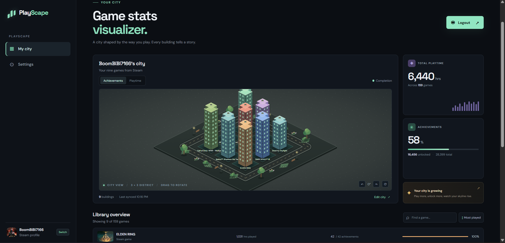

# PlayScape

**[Live demo](https://playscape-game-visualizer.onrender.com/)**



PlayScape turns a player's library into a small, rotatable isometric city. Buildings represent games and rise according to achievement completion or playtime. The dashboard also shows library statistics and lets players choose which games appear in the city, along with each building's color and style.

PlayScape uses Steam OpenID for sign-in and the Steam Web API for profile and game data. Steam handles the user's password; the app does not receive or store it. The project does not require a database.

## Features

- Sign in to Steam and sync the signed-in profile and owned games.
- Browse and search the returned game library, sort by playtime, and reveal more games in batches.
- View a city of up to nine selected games and rotate it by dragging or using the rotation controls.
- Change a building's game, color, and appearance. The city layout is saved in that browser's local storage.
- Switch between achievement and playtime views, and choose a dark or light theme.
- See achievement data where Steam makes it available.

## Requirements

- Node.js 18 or later (the server uses the built-in `fetch` API).
- A Steam Web API key.
- A Steam account with **Game details** set to public to retrieve owned games and playtime.

## Setup

1. Install dependencies:

   ```sh
   npm install
   ```

2. Copy `.env.example` to `.env` and fill in the values:

   ```dotenv
   PORT=3000
   STEAM_API_KEY=your_steam_web_api_key
   SESSION_SECRET=replace_with_a_long_random_secret
   APP_URL=http://localhost:3000
   ```

   Create a key at [Steam Web API Key](https://steamcommunity.com/dev/apikey). Use a long, private value for `SESSION_SECRET`. Keep `.env` out of version control; it is already ignored by `.gitignore`.

3. In Steam's privacy settings, make **Game details** public.

4. Start the development server:

   ```sh
   npm run dev
   ```

5. Open <http://localhost:3000> and choose **Connect Steam**. Use the same host and port as `APP_URL` (for example, don't switch between `localhost` and `127.0.0.1` during sign-in).

For production, set `APP_URL` to the site's public HTTPS URL and configure `STEAM_API_KEY` and `SESSION_SECRET` as deployment environment variables. The included `render.yaml` describes a Render web service; `STEAM_API_KEY` must be added as a secret when deploying.

## How it works

1. Express serves the static frontend from `public/` and exposes the Steam routes under `/api/steam`.
2. **Connect Steam** starts Steam OpenID sign-in. The server creates a short-lived login state and redirects the browser to Steam.
3. Steam redirects back to `/api/steam/callback`. The server checks the state, verifies Steam's OpenID response, and validates the returned 17-digit Steam ID.
4. The server signs that ID with `SESSION_SECRET` and sets it in an HTTP-only cookie. The API key stays on the server.
5. The browser calls `/api/steam/sync`. The server requests the player's profile and owned games, then looks up achievement totals for the nine most-played games. Additional achievement data can be requested in batches through `/api/steam/achievements`.
6. The frontend renders the game library and city. It keeps the selected city layout and theme in browser `localStorage`; it fetches account and game data from Steam again when the page is loaded.

## Project structure

```text
public/
  components/building.js   Isometric city SVG renderer
  styles/                  Sidebar, dashboard, library, and responsive styles
  index.html               Main page markup
  script.js                Page state, rendering, interactions, and Steam API calls
  style.css                Shared base styles
routes/
  steam.js                 Steam OpenID, session cookie, and Steam API endpoints
server.js                  Express app and static-file hosting
.env.example               Environment variable template
render.yaml                Render deployment configuration
STEAM_SETUP.md             Steam credential and connection notes
```

## API routes

- `GET /api/health` — health check.
- `GET /api/steam/login` — begin Steam OpenID sign-in.
- `GET /api/steam/callback` — verify Steam's sign-in response.
- `GET /api/steam/me` — check the signed-in account and profile.
- `POST /api/steam/sync` — fetch the profile and owned games.
- `POST /api/steam/achievements` — retrieve achievement data for up to nine game IDs.
- `POST /api/steam/logout` — clear the login cookie.

## Notes and limitations

- Steam privacy settings must allow access to Game details for the library and playtime to appear.
- Some games do not expose player achievements through Steam; those games display without achievement progress.
- Login sessions are represented by a signed cookie. Pending OpenID login state is kept in server memory and expires after ten minutes, so an in-progress login must be restarted if the server restarts.
- Game data is fetched from Steam when the user syncs; SteamCity does not persist game data in a database.
